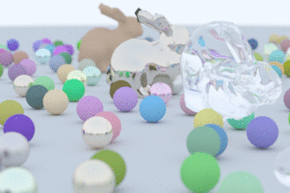
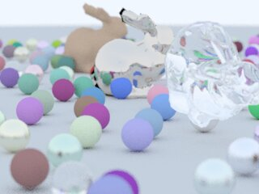

# ntmesh_ray

Header-only ray BVH over an ntmesh, plus two path-tracer samples that put that tree in the final scene from Ray Tracing in One Weekend.

`src/ntmesh_ray_bvh.h` builds a tree over triangles and quads. Triangles use Möller–Trumbore. A quad is two triangles or one bilinear patch. A point-normal array, when passed to the hit, is blended at the hit and kept facing the polygon. N-gons stay out of the tree. Call `clear()` when finished. A plain copy shares the node array.

## Samples

Both samples load `samplegeo/mixed_manifold_bunny.geo`, build one mesh tree, and place three copies in the book's final scene. The mesh tree is built once. A second tree, over the spheres and the three copies, is rebuilt when a copy moves.



- [CUDA](docs/cuda.md) — `rtiow_bvh`, 1200×800, 100 samples, 120 frames. The copy at x = 4 spins about a fixed axis. The loop above is that spin. A still of the first frame is [`samples/CUDA/sample_thumb.jpg`](samples/CUDA/sample_thumb.jpg).



- [CPU](docs/cpu.md) — `rtiow_bvh_cpu`, one 640×480 frame, 16 samples, one row-band per thread. Prints the trace time.

## Documentation

- [Overview](docs/overview.md) — what is in the tree, what the samples share, and which headers they include
- [Ray BVH](docs/ray_bvh.md) — `ntm::RayBVH`, build, hit, and ownership

## Related

- [ntv](https://github.com/ivandewolf1/ntv) is the vector and matrix library. The samples take their camera, materials, and OpenEXR writer from `ntv/samples`.
- [ntmesh](https://github.com/ivandewolf1/ntmesh) is the mesh this tree traces.

## Build

`NTV_ROOT` is the ntv repository, the directory that contains `src/nvec3.h`. `NTMESH_ROOT` is the ntmesh repository, the directory that contains `src/ntmesh.h`.

A `-D` argument wins, then the environment variable of the same name, then a sibling checkout (`../ntv/ntv` and `../ntmesh`). Configuration stops and names the variable when a root is still missing.

CMake 3.18 or newer. The project language list includes CUDA, and the toolkit is required. With CMake 3.24 or newer an empty `CMAKE_CUDA_ARCHITECTURES` becomes `native`. Older CMake defaults that value to `75`.

```
cmake -S . -B build
cmake --build build
./build/ntmesh_ray_tests
```

Run a sample from `build/` so the EXR lands in a known directory.

```
cd build
./rtiow_bvh_cpu
./rtiow_bvh
```

`rtiow_bvh_cpu` writes `frame_00.exr` and prints how long the trace took. `rtiow_bvh` writes `frame_00.exr` through `frame_119.exr`. The two binaries use the same file names.
